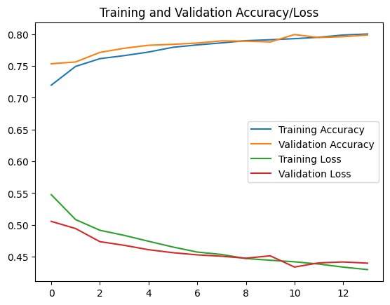
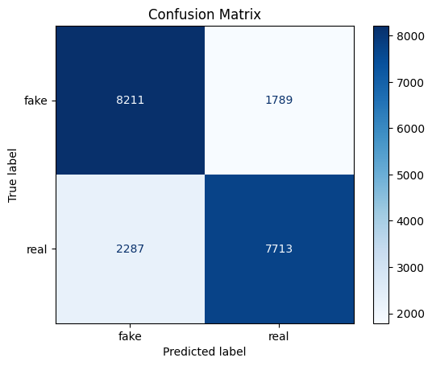
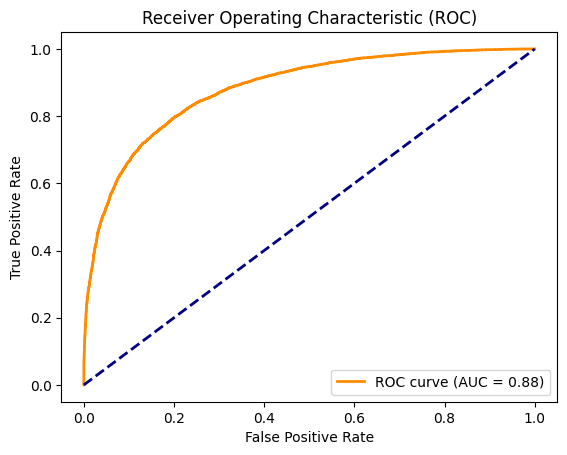

# AI-Generated Face Detector (MobileNetV2 + Tkinter GUI)

A deep learning project that classifies a face image as **real** or **AI-generated (fake)**. It uses transfer learning with a pre-trained MobileNetV2 CNN, and comes with a desktop GUI where you can upload an image and see the prediction with a confidence score.

Built as a final project for a BSCS course.

---

## Table of Contents

- [Project Overview](#project-overview)
- [Methodology](#methodology)
- [Results](#results)
- [Limitations](#limitations)
- [Getting Started](#getting-started)
- [Project Structure](#project-structure)
- [Possible Improvements](#possible-improvements)

---

## Project Overview

### Problem

AI image generators can now produce faces that are hard to tell apart from real photos. This makes it easier to create fake profiles, misleading content, and other forms of misinformation.

### Goal

Train a binary image classifier that predicts whether a face image is real or AI-generated, and wrap it in a simple GUI so anyone can try it without writing code.

### Approach

Instead of training a CNN from scratch, this project uses **transfer learning**. A MobileNetV2 network pre-trained on ImageNet acts as a frozen feature extractor, and a small classification head is trained on top of it to separate real from fake faces.

### Features

- Binary classification: **Real** vs. **AI-Generated**
- Prediction with a confidence percentage
- Tkinter desktop app with image preview and color-coded results
- Separate notebooks for training and evaluation

### Tech Stack

- Python 3
- TensorFlow / Keras (MobileNetV2, `ImageDataGenerator`)
- scikit-learn (confusion matrix, classification report, ROC/AUC)
- NumPy, Matplotlib, Seaborn
- Pillow and Tkinter (GUI)

### Dataset

The model was trained and tested on the **140k Real and Fake Faces** dataset from Kaggle (`real_vs_fake`), split into three folders:

| Split      | Images  |
| ---------- | ------- |
| Train      | 100,000 |
| Validation | 20,000  |
| Test       | 20,000 (10,000 fake and 10,000 real) |

Class labels used by the generator: `{'fake': 0, 'real': 1}`.

---

## Methodology

### 1. Data loading and preprocessing

Images are loaded with Keras `ImageDataGenerator.flow_from_directory`, resized to **128 × 128**, and rescaled to the 0–1 range (`rescale=1./255`) in batches of 32.

- **Training set augmentation:** horizontal flip, zoom (up to 20%), and rotation (up to 10°) to help the model generalize.
- **Validation and test sets:** rescaling only, with no augmentation.

### 2. Model architecture

MobileNetV2 (ImageNet weights, no top layer, 128 × 128 × 3 input) is used as a **frozen** base. A custom head is added on top:

| Layer                   | Output shape   | Notes                          |
| ----------------------- | -------------- | ------------------------------ |
| MobileNetV2 (frozen)    | (4, 4, 1280)   | 2,257,984 params (non-trainable) |
| GlobalAveragePooling2D  | (1280)         | Flattens feature maps          |
| Dense (ReLU)            | (128)          | 163,968 params                 |
| Dropout (0.3)           | (128)          | Reduces overfitting            |
| Dense (Sigmoid)         | (1)            | Probability that image is **real** |

Total parameters: **2,422,081** (of which **164,097** are trainable).

### 3. Training

| Setting        | Value                                                        |
| -------------- | ------------------------------------------------------------ |
| Optimizer      | Adam                                                         |
| Loss           | Binary cross-entropy                                         |
| Metric         | Accuracy                                                     |
| Max epochs     | 20                                                           |
| Early stopping | Monitors `val_accuracy`, patience 3, restores best weights   |

Training stopped early at **epoch 14**, and the weights from the best epoch (**epoch 11**) were restored. The final model is saved as `FP_fake_image_detector_modelV2.h5`.



### 4. Evaluation

The saved model was evaluated on the 20,000-image test set (not shuffled, so predictions line up with labels) using a confusion matrix, a classification report (precision, recall, F1), and the ROC curve with AUC. A prediction above 0.5 is labeled **real**, otherwise **fake**.

### 5. GUI inference

`FP_GUI.py` loads the trained model and applies the same preprocessing used in training (resize to 128 × 128, divide by 255). The model outputs a probability `p` that the image is real:

- `p < 0.5` → **AI-Generated**, confidence = `(1 − p) × 100`
- `p ≥ 0.5` → **Real**, confidence = `p × 100`

The result text is color-coded: **red** for AI-Generated, **green** for Real, and **orange** when the confidence is within 45–55% (the model is unsure).

---

## Results

### Training

| Metric (best epoch, 11) | Value  |
| ----------------------- | ------ |
| Validation accuracy     | 0.7994 |
| Validation loss         | 0.4338 |

Accuracy improved steadily from 0.753 (validation, epoch 1) to about 0.80, and training and validation accuracy stayed close together, so there are no strong signs of overfitting.

### Test set performance

| Class        | Precision | Recall | F1-score | Support |
| ------------ | --------- | ------ | -------- | ------- |
| Fake         | 0.78      | 0.82   | 0.80     | 10,000  |
| Real         | 0.81      | 0.77   | 0.79     | 10,000  |
| **Accuracy** |           |        | **0.80** | 20,000  |
| Macro avg    | 0.80      | 0.80   | 0.80     | 20,000  |

**ROC AUC: 0.88**



|                 | Predicted fake | Predicted real |
| --------------- | -------------- | -------------- |
| **Actual fake** | 8,211          | 1,789          |
| **Actual real** | 2,287          | 7,713          |



### Discussion

- The model reaches about **80% accuracy** on 20,000 unseen test images, matching its validation accuracy, so the result is consistent and not a fluke of the validation set.
- The AUC of **0.88** shows the model separates the two classes well across thresholds, even though accuracy at the default 0.5 threshold is lower.
- It catches slightly more fakes (82% recall) than reals (77% recall). About **23% of real faces** (2,287 of 10,000) are wrongly flagged as AI-generated, and about **18% of fake faces** (1,789 of 10,000) slip through as real.
- This is a reasonable result for a frozen backbone and a small head. The ImageNet features were not trained to spot generation artifacts, which likely caps accuracy.

---

## Limitations

- **Faces only.** The model was trained on a face dataset. The GUI accepts any image file, but predictions on non-face images (landscapes, objects, art) are not meaningful.
- **One kind of fake.** It learned the generator(s) in this dataset. It may perform worse on faces from newer or different AI tools.
- **Not a verdict.** With around 80% accuracy, it should be treated as a hint and not as proof that an image is real or fake.
- **Low resolution.** Images are shrunk to 128 × 128, which discards fine detail that could reveal artifacts.
- **Confidence is not calibrated.** The percentage shown is the sigmoid output and is not a guaranteed probability of being correct. Because the GUI reports the winning class, its confidence is always at least 50%, so the orange "uncertain" color effectively covers 50–55%.

---

## Getting Started

### 1. Clone the repository

```bash
git clone https://github.com/ven-62/fake-face-detector.git
cd ai-fake-face-detector
```

### 2. Install dependencies

```bash
pip install tensorflow numpy pillow matplotlib seaborn scikit-learn
```

Tkinter is included with most Python installs. On some Linux systems you may need `sudo apt install python3-tk`.

### 3. Run the GUI

Keep `FP_fake_image_detector_modelV2.h5` in the same folder as the script:

```bash
python FP_GUI.py
```

Click **Upload Image**, choose a face photo, and the prediction appears below the preview.

### Retraining or re-evaluating (optional)

Both notebooks were run on Kaggle, so their paths point to `/kaggle/input/...`. To run them elsewhere:

1. Download the 140k Real and Fake Faces dataset from Kaggle.
2. Update `TRAIN_DIR`, `VAL_DIR`, and `test_dir` to your local paths.
3. In the training notebook, replace the local MobileNetV2 weights path with `weights='imagenet'`, or point it to your own copy of the weights file.
4. In the evaluation notebook, update the `load_model(...)` path to your `.h5` file.

---

## Project Structure

```
.
├── FP_Lavapie_BSCS2A.ipynb              # Model training notebook
├── FP_model_evaluation.ipynb            # Test set evaluation notebook
├── FP_fake_image_detector_modelV2.h5    # Trained model
├── FP_GUI.py                            # Tkinter app
├── images/
│   ├── training_curves.png
│   ├── confusion_matrix.png
│   └── roc_curve.png
└── README.md
```

---

## Possible Improvements

- **Fine-tune** the top layers of MobileNetV2 instead of keeping the whole base frozen
- Train at a higher resolution, or try a larger backbone (EfficientNet, ResNet)
- Test on faces from other generators to measure how well the model generalizes
- Add a face-detection step so non-face images are rejected
- Tune the decision threshold, or calibrate probabilities
- Add Grad-CAM heatmaps to show which regions drove a prediction
- Package the app as a web demo (Streamlit or Gradio)

---


## License

This project is for educational purposes. Add a license (e.g. MIT) if you plan to share or reuse it. The dataset has its own license on Kaggle.
